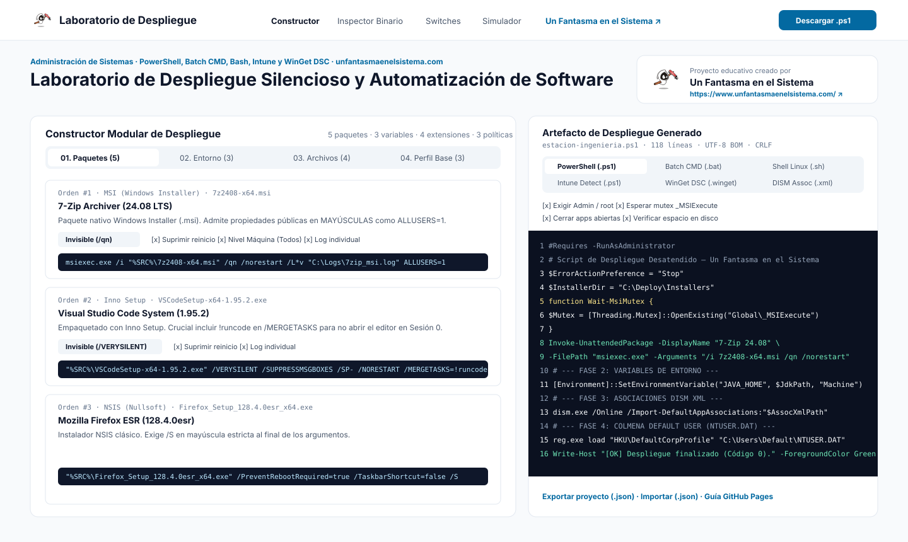
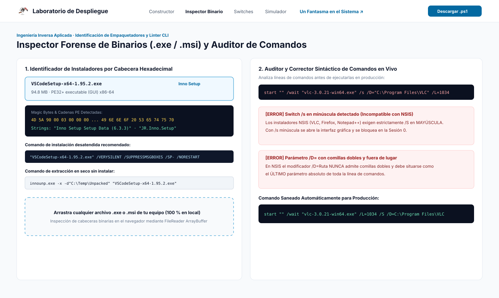
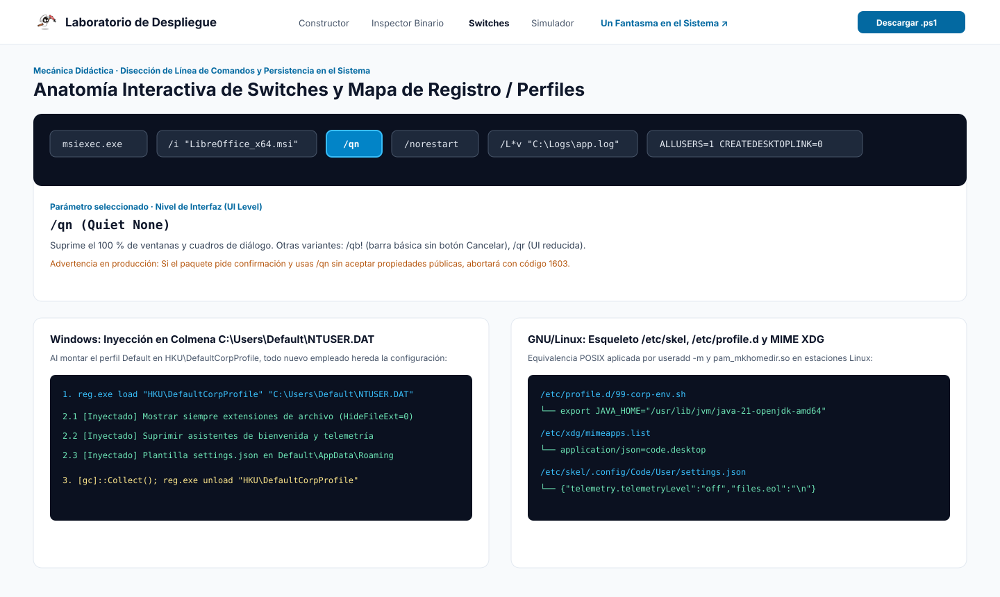
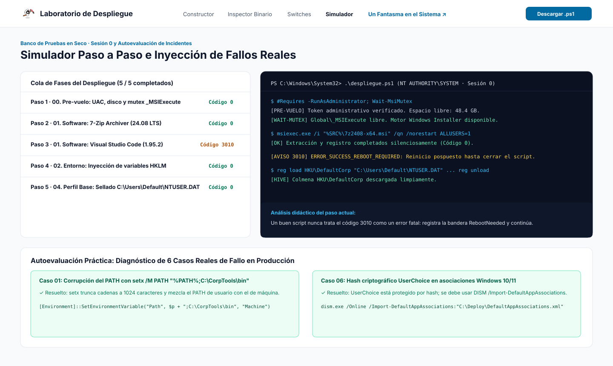

<div align="center">
  <a href="https://www.unfantasmaenelsistema.com/" target="_blank" rel="noopener noreferrer">
    
  </a>

  # Laboratorio de Despliegue Silencioso y Automatización de Software

  **Herramienta visual, forense y didáctica para construir, auditar y simular scripts de instalación desatendida (`.ps1`, `.bat`, `.sh`, reglas Intune/SCCM, manifiestos WinGet DSC y asociaciones DISM XML).**

  Un recurso abierto creado por [**Un Fantasma en el Sistema**](https://www.unfantasmaenelsistema.com/) para administradores de sistemas, ingenieros de despliegue (Intune, MECM/SCCM, GPO, Ansible) y estudiantes de Formación Profesional (**SMR · ASIR · DAW · DAM**) e Ingeniería Informática.

  [**🌐 Visitar Un Fantasma en el Sistema**](https://www.unfantasmaenelsistema.com/) · [**🚀 Guía de Despliegue en GitHub Pages**](#-despliegue-en-github-pages-listo-para-subir) · [**📖 Mecánica Didáctica**](#-mecánica-didáctica-y-fundamentos-técnicos)
</div>

---

## 📸 Capturas del Laboratorio

### 1. Constructor Modular e Inspector Multi-Formato en Vivo
Construye colas de despliegue en 4 fases (Software, Variables de Entorno, Asociaciones de Archivo y Perfil Predeterminado Corporativo) mientras inspeccionas el código generado en tiempo real con comprobaciones empresariales de pre-vuelo (espera de mutex `Global\_MSIExecute`, cierre preventivo de procesos y verificación de espacio en disco).



---

### 2. Inspector Forense de Binarios (`.exe` / `.msi`) y Auditor Sintáctico CLI
Analiza cualquier archivo `.exe` o `.msi` local desde tu navegador (100 % en cliente mediante `FileReader` / `ArrayBuffer`) para identificar su empaquetador por *Magic Bytes* y cadenas PE (`Inno Setup`, `NSIS`, `MSI`, `WiX Burn`, `InstallShield`), o pega cualquier línea de comandos en el **Auditor en Vivo** para detectar fallos reales antes de llevarlos a producción.



---

### 3. Anatomía Interactiva de Switches y Mapa de Persistencia (`NTUSER.DAT` / `/etc/skel`)
Haz clic sobre cada token de un comando desatendido para comprender su función exacta y visualiza cómo fluyen los cambios en el Registro de Windows (`HKLM`, `HKU\DefaultCorpProfile`) y en sistemas POSIX (`/etc/profile.d`, `/etc/xdg/mimeapps.list`, `/etc/skel`).



---

### 4. Simulador de Ejecución en Sesión 0 y Retos de Diagnóstico
Ejecuta tu cola paso a paso en una terminal simulada bajo contexto `NT AUTHORITY\SYSTEM` (Sesión 0), inyecta incidentes reales (colisión de mutex `1618`, reinicio diferido `3010`, falta de elevación o bloqueo por `/s` minúscula en NSIS) y resuelve **6 casos reales de producción**.



---

## ✨ Características Principales

| Módulo del Laboratorio | Qué aporta en el aula y en entornos reales de TI |
| :--- | :--- |
| **Constructor Multi-Formato (6 Salidas)** | Genera scripts listos para producción en **PowerShell (`.ps1`)**, **Batch CMD (`.bat`)**, **Shell Linux (`.sh`)**, **Reglas de Detección Intune/SCCM (`Detect-*.ps1`)**, **WinGet Configuration DSC (`.winget`)** y **Plantillas DISM (`DefaultAppAssociations.xml`)**. |
| **Catálogo Real por Motor de Instalación** | 12 paquetes corporativos preconfigurados (*7-Zip*, *VS Code*, *Firefox ESR*, *LibreOffice*, *Git*, *VLC*, *Python 3.12*, *Acrobat Reader DC*, *Chrome Enterprise*, *Notepad++*, *Node.js LTS*, *WireGuard*) + creación de paquetes personalizados. |
| **Inspector Forense de Instaladores Local** | Permite arrastrar cualquier `.exe` o `.msi` desde tu ordenador para detectar el motor de empaquetado inspeccionando sus cabeceras hexadecimales (`D0 CF 11 E0`, secciones `.wixburn`, firmas `NullsoftInst` o `Inno Setup Setup Data`) sin subir datos a ningún servidor. |
| **Auditor y Corrector de Comandos CLI** | Detecta automáticamente trampas críticas: `/s` en minúscula en NSIS, comillas prohibidas en `/D=Ruta`, propiedades privadas en minúscula en MSI, truncamiento destructivo de `setx PATH` y ausencia de `-Wait` en PowerShell. |
| **Gestión Segura de Variables de Entorno** | Evita el límite destructivo de 1024 caracteres de `setx.exe` utilizando `[Environment]::SetEnvironmentVariable(..., 'Machine')` de forma idempotente en Windows y scripts modulares en `/etc/profile.d/99-corp-env.sh` en GNU/Linux. |
| **Asociaciones de Archivo Corporativas** | Explica y genera la doble capa `assoc` + `ftype` junto con el XML de `dism.exe /Online /Import-DefaultAppAssociations` para superar la protección de hash criptográfico `UserChoice` de Windows 10/11, además de `/etc/xdg/mimeapps.list` en Linux. |
| **Sellado del Perfil Predeterminado (`Default User`)** | Monta temporalmente `C:\Users\Default\NTUSER.DAT` en `HKU\DefaultCorpProfile` (con descarga segura `reg unload`) y configura `/etc/skel` para que todo nuevo empleado herede un entorno limpio y seguro en su primer inicio de sesión. |
| **Codificación y Finales de Línea Exactos** | Exporta `.ps1` en `UTF-8 con BOM + CRLF` (compatibilidad total con Windows PowerShell 5.1), `.bat` en `CP65001 + CRLF` y `.sh` en `UTF-8 sin BOM + LF` estricto (evitando el error `bad interpreter: ^M` en el kernel Linux). |

---

## 📖 Mecánica Didáctica y Fundamentos Técnicos

### 1. Referencia Rápida de Motores y Switches Silenciosos

| Motor / Empaquetador | Cómo Identificarlo (Cabecera / Strings) | Switch Silencioso Total | Barra Pasiva | Evitar Reinicio | Registro de Auditoría (Log) |
| :--- | :--- | :--- | :--- | :--- | :--- |
| **Windows Installer (`.msi`)** | Cabecera `D0 CF 11 E0` (OLE2 Compound File) | `/qn` | `/qb!` | `/norestart` | `/L*v "C:\Logs\app.log"` |
| **Inno Setup (`.exe`)** | Cadena `"Inno Setup Setup Data"` en binario | `/VERYSILENT /SUPPRESSMSGBOXES /SP-` | `/SILENT` | `/NORESTART` | `/LOG="C:\Logs\app.log"` |
| **NSIS Nullsoft (`.exe`)** | Cadena `"NullsoftInst"` / `"Nullsoft.NSIS"` | `/S` *(mayúscula estricta)* | `/S` | Depende del script | N/A *(directorio con `/D=Ruta` sin comillas al final)* |
| **WiX Burn Bundle (`.exe`)** | Sección PE `.wixburn` / `"WixBurnManifest"` | `/quiet` | `/passive` | `/norestart` | `/log "C:\Logs\app.log"` |
| **InstallShield (`.exe`)** | Cadena `"InstallShield"` / `setup.ini` | `/s /v"/qn /norestart"` o `/sAll /rs` | `/sPB` | `/msi /norestart` | `/L*v "C:\Logs\app.log"` |
| **APT / Dpkg (`.deb` Linux)** | Paquetes Debian / Ubuntu en scripts Bash | `DEBIAN_FRONTEND=noninteractive apt-get install -y -q` | `apt-get install -y` | No reinicia el SO | `-o Dpkg::Options::="--force-confdef"` |

### 2. Códigos de Retorno Estándar (`%ERRORLEVEL%` / `$LASTEXITCODE`)
- **`0` (`ERROR_SUCCESS`)**: Instalación completada limpiamente.
- **`3010` (`ERROR_SUCCESS_REBOOT_REQUIRED`)**: Instalación **exitosa**, pero quedan archivos en uso pendientes de sustitución en el próximo reinicio (`PendingFileRenameOperations`). Un script profesional **nunca** debe abortar ante un código `3010`.
- **`1641` (`ERROR_SUCCESS_REBOOT_INITIATED`)**: El instalador ha iniciado un reinicio inmediato. Prevenir siempre con `/norestart`.
- **`1618` (`ERROR_INSTALL_ALREADY_RUNNING`)**: Otra instancia de `msiexec.exe` mantiene ocupado el mutex global `Global\_MSIExecute`. Se mitiga esperando a que el mutex quede libre antes de invocar el paquete.
- **`1603` (`ERROR_INSTALL_FAILURE`)**: Fallo fatal interno. Abrir el archivo generado con `/L*v` y buscar hacia arriba desde la cadena `"Return value 3"`.

---

## 💻 Instalación y Ejecución Local

Requisitos previos: **Node.js 18+** y **npm**.

```bash
# 1. Clonar el repositorio
git clone https://github.com/TU_USUARIO/laboratorio-despliegue-silencioso.git
cd laboratorio-despliegue-silencioso

# 2. Instalar dependencias
npm install

# 3. Iniciar servidor de desarrollo (http://localhost:3000)
npm run dev
```

Para verificar tipos TypeScript y generar la compilación estática de producción en la carpeta `dist/`:

```bash
npm run lint
npm run build
```

---

## 🚀 Despliegue en GitHub Pages (Listo para Subir)

Este repositorio está preconfigurado para funcionar de inmediato en **GitHub Pages** sin necesidad de tocar rutas ni configuraciones:

1. **`vite.config.ts` incluye `base: './'`**, por lo que todos los assets, fuentes e iconos funcionan en cualquier subruta (`https://tu-usuario.github.io/nombre-repo/`) o dominio personalizado.
2. **Incluye `public/.nojekyll`** para evitar que Jekyll filtre recursos estáticos.
3. **Incluye el workflow oficial `.github/workflows/deploy-pages.yml`**.

### Pasos para publicarlo en tu cuenta de GitHub:

1. Crea un repositorio nuevo en GitHub y sube el código:
   ```bash
   git init
   git add .
   git commit -m "feat: versión inicial del Laboratorio de Despliegue Silencioso"
   git branch -M main
   git remote add origin https://github.com/TU_USUARIO/TU_REPOSITORIO.git
   git push -u origin main
   ```
2. En tu repositorio de GitHub, entra en **Settings → Pages**.
3. En el desplegable **Build and deployment → Source**, selecciona **GitHub Actions**.
4. El workflow **Desplegar en GitHub Pages** se ejecutará automáticamente y en menos de 1 minuto tendrás la aplicación publicada en vivo.

---

## 🗂️ Estructura del Proyecto

```text
├── .github/workflows/
│   └── deploy-pages.yml              # Publicación automática en GitHub Pages con GitHub Actions
├── docs/screenshots/                 # Capturas de pantalla vectoriales de alta resolución para el README
├── public/
│   ├── .nojekyll                     # Desactiva procesado Jekyll en GitHub Pages
│   └── assets/aistudio/              # Logotipo oficial de Un Fantasma en el Sistema
├── src/
│   ├── components/
│   │   ├── BinaryAndCommandLab.tsx   # Inspector forense .exe/.msi local y auditor CLI en tiempo real
│   │   ├── BrandMark.tsx             # Identidad visual con fallback resiliente
│   │   ├── DiagnosticChallenges.tsx  # 6 retos interactivos de resolución de incidentes reales
│   │   ├── ExecutionSimulator.tsx    # Simulador paso a paso en Sesión 0 con inyección de fallos
│   │   ├── PipelineBuilder.tsx       # Constructor de 4 etapas (Paquetes, Entorno, Archivos, Perfil)
│   │   ├── ScriptInspector.tsx       # Generador en vivo (.ps1, .bat, .sh, Intune, WinGet, XML) y JSON
│   │   ├── SwitchAnatomySection.tsx  # Disección interactiva de comandos y tabla de Exit Codes
│   │   └── SystemArchitectureMap.tsx # Mapa comparativo Registro Windows (NTUSER.DAT) vs Linux (/etc/skel)
│   ├── data/
│   │   └── catalog.ts                # Catálogo de 12 paquetes, muestras forenses y retos de auditoría
│   ├── types/
│   │   └── deployment.ts             # Modelos de datos y enumeraciones TypeScript
│   ├── utils/
│   │   └── scriptGenerator.ts        # Motores de generación de scripts, auditoría CLI y simulación
│   ├── App.tsx                       # Composición principal y gestión de escenarios corporativos
│   └── index.css                     # Configuración tipográfica (Plus Jakarta Sans, Public Sans, IBM Plex Mono)
├── index.html                        # Metadatos SEO, OpenGraph y carga tipográfica
├── LICENSE                           # Licencia MIT
├── package.json                      # Scripts y dependencias del proyecto
└── vite.config.ts                    # Configuración Vite con base relativa './' para GitHub Pages
```

---

## 👤 Autoría y Enlaces

Creado para [**Un Fantasma en el Sistema**](https://www.unfantasmaenelsistema.com/).

- 🌐 **Sitio Web y Blog Técnico**: [https://www.unfantasmaenelsistema.com/](https://www.unfantasmaenelsistema.com/)
- 📄 **Licencia**: Distribuido bajo licencia [MIT](./LICENSE). Libre para uso docente, laboratorios de Formación Profesional, universidades y departamentos de sistemas.
