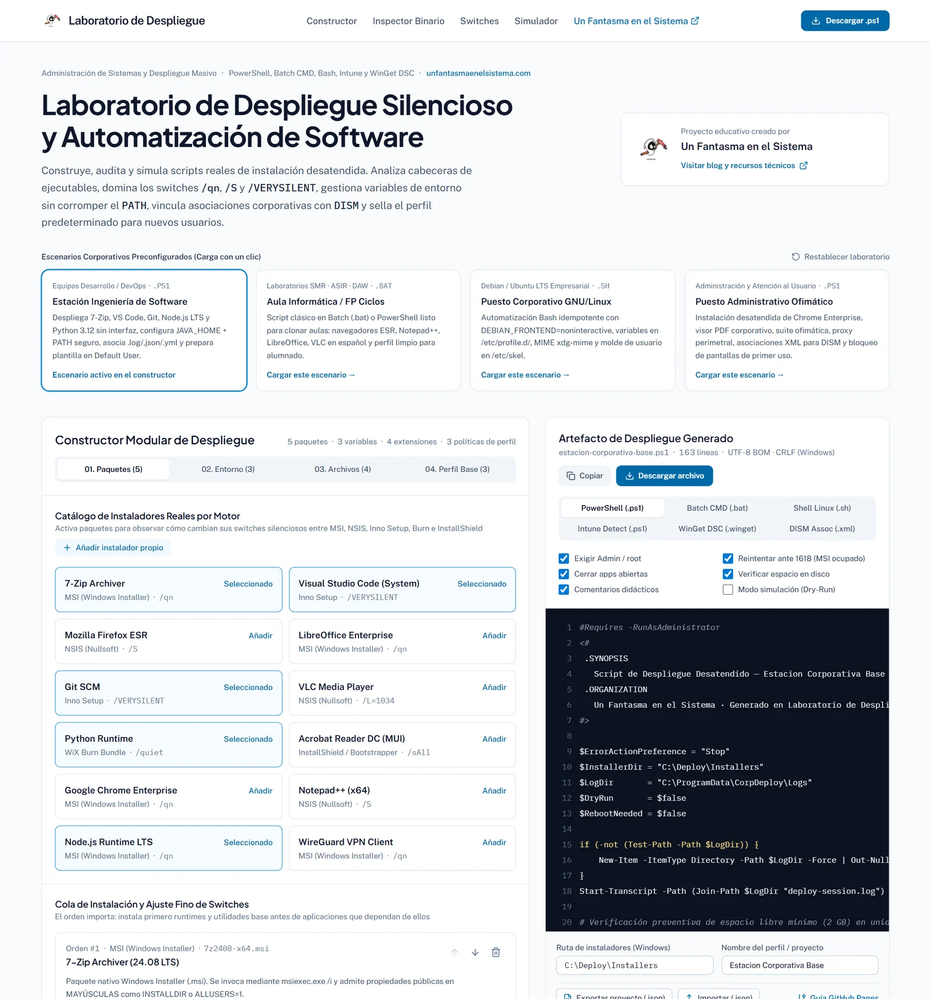
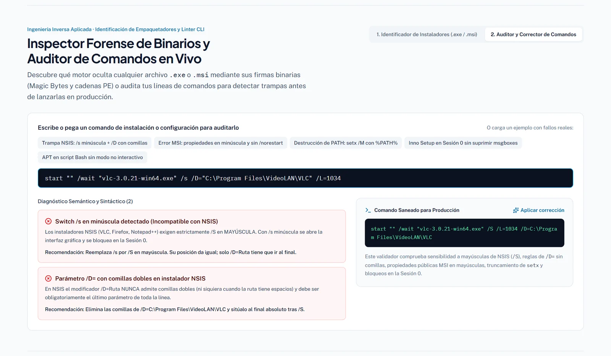
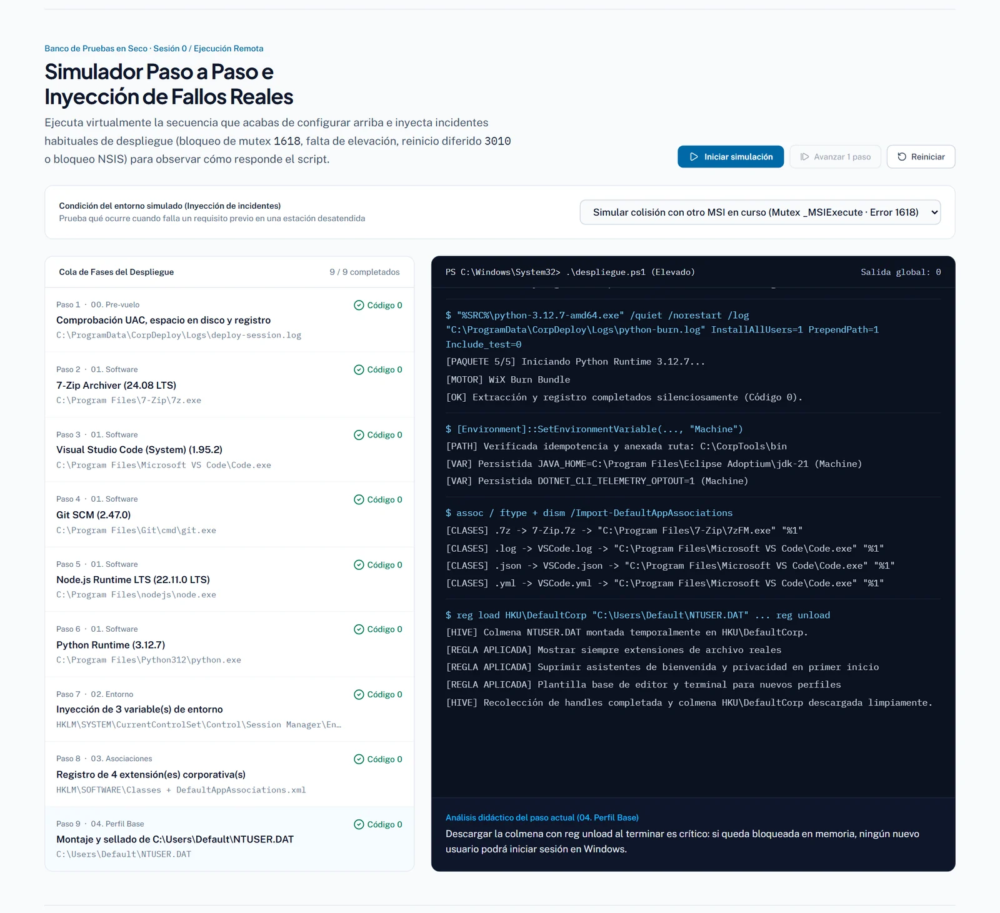
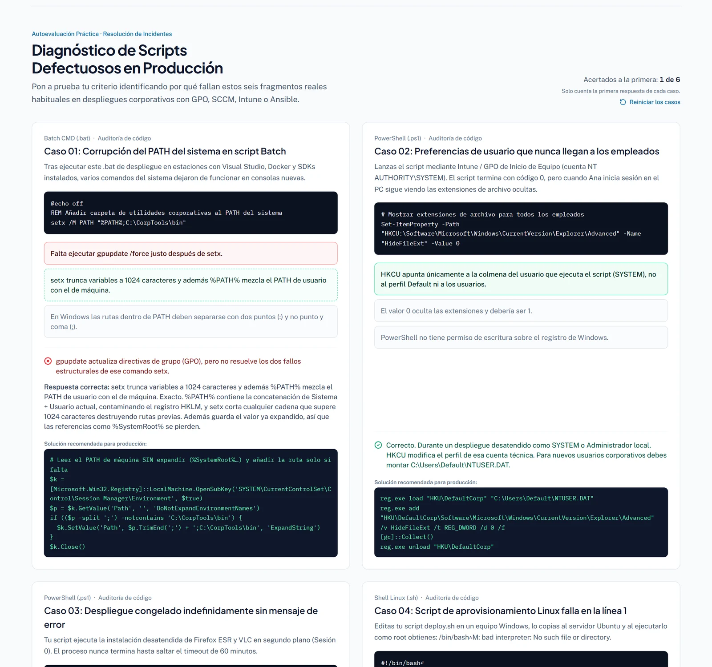

<p align="center">
  <a href="https://www.unfantasmaenelsistema.com"></a>
</p>

<h1 align="center">Laboratorio de Despliegue Silencioso</h1>

<p align="center">
  <b>Construye, audita y simula scripts de instalación desatendida para Windows y Linux</b><br>
  PowerShell, Batch, Bash, detección Intune, WinGet DSC y XML de DISM · MSI, Inno Setup, NSIS, WiX Burn y Adobe · 6 casos de diagnóstico
</p>

<p align="center">
  <a href="https://unfantasmaenelsistema.github.io/Laboratorio-Despliegue-Silencioso/"><b>▶ Abrir el laboratorio</b></a> ·
  <a href="#qué-hace">Qué hace</a> ·
  <a href="#switches-por-motor">Switches por motor</a> ·
  <a href="#códigos-de-retorno">Códigos de retorno</a> ·
  <a href="#desarrollo">Desarrollo</a> ·
  <a href="https://www.unfantasmaenelsistema.com">unfantasmaenelsistema.com</a> ·
  <a href="LICENSE">MIT</a>
</p>

<p align="center">
  
  
  
  
</p>

<p align="center">
  
</p>

Un banco de pruebas para aprender a desplegar software sin intervención del usuario, como se hace con GPO, Intune, MECM/SCCM o Ansible. Se eligen los paquetes, las variables de entorno, las asociaciones de archivo y las reglas del perfil predeterminado, y el laboratorio genera el script completo, explica cada switch y permite simular qué pasa cuando algo falla: otra instalación en curso, falta de elevación, un reinicio pendiente o un `/s` en minúscula.

> [!NOTE]
> Todo funciona en el navegador, sin servidor. El proyecto y las respuestas a los casos se guardan solo en el `localStorage` de ese navegador, y los `.exe` o `.msi` que se analizan en el inspector no salen del equipo.

> [!WARNING]
> Los scripts generados tocan el registro (`HKLM`, `NTUSER.DAT` del perfil Default), el `PATH` y las asociaciones de archivo. Pruébalos primero en una máquina virtual, con la opción **Modo simulación (Dry-Run)** si hace falta.

## Qué hace

- **Constructor en cuatro fases**: paquetes, variables de entorno, asociaciones de archivo y perfil predeterminado (`C:\Users\Default\NTUSER.DAT` en Windows, `/etc/skel` en Linux). Incluye 12 paquetes reales (7-Zip, VS Code, Firefox ESR, LibreOffice, Git, VLC, Python, Acrobat Reader, Chrome Enterprise, Notepad++, Node.js y WireGuard), instaladores propios y cuatro escenarios preparados.
- **Seis salidas**: PowerShell (`.ps1`, UTF-8 con BOM y CRLF), Batch (`.bat`, CRLF), Bash (`.sh`, LF sin BOM), regla de detección para Intune o MECM, configuración WinGet DSC y el `DefaultAppAssociations.xml` de DISM.
- **Inspector de instaladores**: identifica el motor de un `.exe` o `.msi` local por sus cabeceras y cadenas (`D0 CF 11 E0` en MSI, `.wixburn`, `NullsoftInst`, `Inno Setup Setup Data`) y propone el comando silencioso y el de extracción.
- **Auditor de comandos**: detecta y corrige `/s` en minúscula en NSIS, `/D=` entre comillas, propiedades MSI en minúscula, rutas `.msi` con espacios sin comillas, falta de `/norestart`, `setx` sobre `PATH`, `Start-Process` sin `-Wait`, Inno Setup sin `/SUPPRESSMSGBOXES` y `apt` interactivo.
- **Anatomía de switches y mapa de persistencia**: qué hace cada parte de una línea de instalación y dónde queda escrito cada cambio.
- **Simulador paso a paso** con inyección de fallos: 1618 (Windows Installer ocupado), 3010 (reinicio pendiente), error 5 sin elevación y bloqueo de NSIS en la Sesión 0.
- **Seis casos de diagnóstico** con fragmentos rotos reales: `setx` que destroza el `PATH`, `HKCU` ejecutado como SYSTEM, NSIS colgado, CRLF en un script Bash, error 1618 y el hash de `UserChoice`.

<p align="center">
  
</p>

<p align="center">
  
</p>

### Los casos de diagnóstico

Solo cuenta la primera respuesta de cada caso: al elegir una opción, el caso queda cerrado y, si la respuesta es incorrecta, se muestra la correcta con su explicación y la solución para producción. El botón «Reiniciar los casos» los deja como al principio.

<p align="center">
  
</p>

## Switches por motor

| Motor | Cómo reconocerlo | Silencioso | Con barra de progreso | Sin reinicio | Log |
| :-- | :-- | :-- | :-- | :-- | :-- |
| Windows Installer (`.msi`) | Cabecera `D0 CF 11 E0` (OLE2) | `/qn` | `/qb!` | `/norestart` | `/L*v "C:\Logs\app.log"` |
| Inno Setup (`.exe`) | Cadena `Inno Setup Setup Data` | `/VERYSILENT /SUPPRESSMSGBOXES /SP-` | `/SILENT` | `/NORESTART` | `/LOG="C:\Logs\app.log"` |
| NSIS (`.exe`) | Cadena `NullsoftInst` | `/S` (en mayúscula) | — | Según el instalador | — |
| WiX Burn (`.exe`) | Sección PE `.wixburn` | `/quiet` | `/passive` | `/norestart` | `/log "C:\Logs\app.log"` |
| InstallShield (`.exe`) | Cadena `InstallShield` | `/s /v"/qn"` | — | `/v"/norestart"` | `/v"/L*v C:\Logs\app.log"` |
| Bootstrapper de Adobe (`.exe`) | Firma de Adobe, `setup.ini` | `/sAll /rs /rps` | `/sPB /rs` | `/msi /norestart` | `/msi /L*v "C:\Logs\app.log"` |
| APT (Debian/Ubuntu) | — | `DEBIAN_FRONTEND=noninteractive NEEDRESTART_MODE=a apt-get install -y -q` | — | — | `/var/log/apt/` |

- En NSIS, `/S` puede ir en cualquier posición; el único parámetro con posición fija es `/D=Ruta`, que va el último y sin comillas aunque la ruta tenga espacios.
- En MSI solo las propiedades públicas (todo en mayúsculas, como `ALLUSERS=1`) llegan a la fase de instalación.
- En el bootstrapper de Adobe, todo lo que va detrás de `/msi` se pasa a `msiexec`.

## Códigos de retorno

| Código | Nombre | Qué hacer en el script |
| :-: | :-- | :-- |
| `0` | `ERROR_SUCCESS` | Seguir. |
| `3010` | `ERROR_SUCCESS_REBOOT_REQUIRED` | Es un éxito: anotar que hace falta reiniciar y seguir. |
| `1641` | `ERROR_SUCCESS_REBOOT_INITIATED` | El instalador ha lanzado el reinicio; evitarlo con `/norestart`. |
| `1618` | `ERROR_INSTALL_ALREADY_RUNNING` | Otra instalación MSI tiene ocupado Windows Installer: reintentar (los scripts generados lo hacen hasta 20 veces cada 30 s). |
| `1603` | `ERROR_INSTALL_FAILURE` | Abrir el log `/L*v` y buscar `Return value 3`. |

## Desarrollo

Requisitos: Node.js 20 o superior.

```bash
git clone https://github.com/unfantasmaenelsistema/Laboratorio-Despliegue-Silencioso.git
cd Laboratorio-Despliegue-Silencioso
npm ci
npm run dev      # http://localhost:3000
npm test         # 48 tests de catálogo, generadores, auditor, simulador y casos
npm run lint     # comprobación de tipos
npm run build    # versión estática en dist/
```

Cada `push` a `main` pasa por el workflow [`deploy.yml`](.github/workflows/deploy.yml) (tipos, tests y build) y se publica en GitHub Pages. Los pull requests ejecutan las mismas comprobaciones sin publicar.

```text
src/
├── data/catalog.ts            Paquetes, variables, asociaciones, reglas de perfil, muestras y casos
├── utils/scriptGenerator.ts   Generadores (.ps1, .bat, .sh, Intune, WinGet, XML), auditor y simulador
├── utils/pipelineState.ts     Validación de proyectos guardados o importados
├── utils/challenges.ts        Puntuación de los casos (cuenta la primera respuesta)
├── utils/*.test.ts            Tests (Vitest)
├── App.tsx                    Página, escenarios y estado del proyecto
└── components/                Constructor, inspector, auditor, anatomía, simulador y casos
```

## Novedades de la versión 2

- **Error 1618**: el script esperaba mientras existiera el mutex `Global\_MSIExecute`, que puede existir sin estar ocupado. Ahora PowerShell y Batch reintentan la instalación mientras `msiexec` devuelva 1618, y el caso 05 enseña esa solución tratando 3010 como éxito.
- **DISM**: los scripts importaban `DefaultAppAssociations.xml` sin haberlo escrito nunca. Ahora lo escriben antes de importarlo (here-string en PowerShell y `echo` escapado en Batch).
- **PATH**: se lee del registro sin expandir y se guarda como `REG_EXPAND_SZ`, para no perder referencias como `%SystemRoot%`, y la comprobación de duplicados compara ruta a ruta.
- **NSIS**: el catálogo y el caso 03 decían que `/S` debe ir al final; lo que debe ir al final es `/D=`. El generador ponía `/S` detrás de un `/D=` añadido por el usuario y ahora lo deja el último.
- **Batch**: un nombre con paréntesis, como «Acrobat Reader DC (MUI)», cerraba antes de tiempo el bloque de control de errores; 1641 se trata como reinicio pendiente.
- **Bash**: `NEEDRESTART_MODE=a` para que `apt` no se quede esperando en Ubuntu, paquetes sin duplicar, avisos de los que necesitan repositorio extra y `dconf update` tras escribir la configuración.
- **WinGet DSC**: `PSDscResources/Environment` no admite el destino `User`; las variables de usuario se comentan y los valores van entre comillas simples (en comillas dobles, `\P` sería un escape YAML inválido).
- **Auditor**: marcaba como error un `/S` correcto y convertía `/VERYSILENT` en `/VERYVERYSILENT`.
- **Catálogo**: Acrobat Reader x64 (proceso `Acrobat`, extracción con `-sfx_o`, sin la falsa firma de InstallShield), WinGet `Google.Chrome` para el MSI de Chrome, `SSL_CERT_FILE` frente a `NODE_EXTRA_CA_CERTS`, el proxy de `apt` y otras precisiones.
- **Casos**: se podían probar opciones hasta acertar y el marcador contaba la última; ahora cuenta la primera, la respuesta queda fijada y se guarda.
- **Proyectos**: un `.json` importado o guardado sin alguna sección dejaba la página en blanco; ahora se valida y un archivo no válido muestra un aviso.
- Fuera dependencias sin uso (Gemini, Express, Motion) y las capturas dibujadas en SVG; se arregla la instalación con npm, el terminal del simulador sigue al último paso, el diseño ya no se desborda en móvil ni a 1024 px, y la build lleva CSP.

## Créditos y licencia

Desarrollado para **[Un Fantasma en el Sistema](https://www.unfantasmaenelsistema.com)**. Distribuido bajo licencia [MIT](LICENSE).
